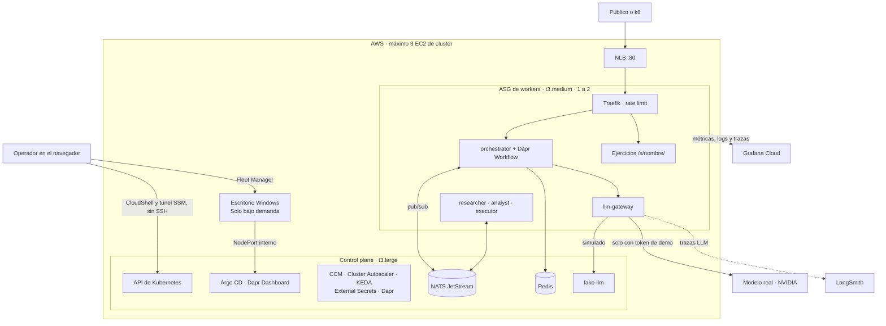
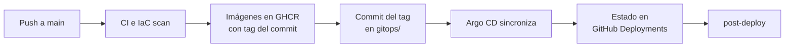

# Agentic Platform

[](https://github.com/Andresm98/03-agentic-platform-swe/actions/workflows/main.yml)
[](https://sonarcloud.io/project/overview?id=Andresm98_03-agentic-platform-swe)
[](LICENSE)

Laboratorio **efímero y reproducible** de una plataforma Kubernetes autogestionada (K3s sobre EC2) que ejecuta una flota de agentes de IA. Se crea desde cero con GitHub Actions, se opera desde el navegador y se destruye al terminar. Cualquier estudiante puede publicar en ella su propio contenedor con un Pull Request.

**El producto evaluado es la plataforma.** Los agentes son una carga de trabajo de demostración: reproducen el comportamiento de un sistema agéntico real, con decisiones de un modelo, delegación entre servicios, colas, reintentos y fallos parciales. No analizan la infraestructura en tiempo real ni son de propósito general.

Un modelo real solo se usa con un token de demo: una prueba de carga o un ataque se atienden con un LLM simulado y **no consumen tokens reales**.

> **Sin alta disponibilidad.** El cluster tiene un único control plane. Si ese nodo se pierde, se pierde el cluster y se recrea desde Git y Terraform. Es una decisión consciente para un laboratorio de coste mínimo, no un diseño de producción.

## Estado real

Actualizado el 2026-11-09. **La plataforma se desplegó en AWS desde cero, sin pasos manuales, y funcionó de extremo a extremo.** Solo se afirma lo que tiene evidencia en la [bitácora de despliegue](docs/bitacora.md) o en el [registro de validación](docs/validation-log.md).

| Área | Estado | Evidencia |
|---|---|---|
| Tests y arquitectura de código | ✅ Probado | Cobertura ≥ 80 % por servicio, 27 contratos de `import-linter` y `mypy` estricto |
| Flota en `docker compose` | ✅ Probado | Tarea `completed` con 0 tokens reales, y reanudación tras matar el orquestador |
| Pipeline `main` | ✅ Probado | CI, escaneo IaC, 6 imágenes y promoción GitOps |
| Capa persistente de AWS | ✅ Desplegada | Terraform sin diferencias |
| Mirror de imágenes | ✅ Probado | 6 imágenes copiadas con su digest y descargables sin login |
| `lab.yml up` desde cero | ✅ Probado | 22 aplicaciones `Synced` y `Healthy`, sin intervención manual |
| Tarea completa por el NLB | ✅ Probado | Orquestador y 3 agentes en unos 23 s, con KEDA escalando desde cero |
| Autoscaling de nodos | ✅ Probado | El ASG subió de 1 a 2 y el nodo se unió como `Ready`, con 2 destinos `healthy` en el NLB. Sin carga, volvió solo a 1 |
| GitOps y self-healing | ✅ Probado | Pod restaurado y cambio manual revertido en 7 s cada uno |
| Ataque y barrera de token | ✅ Probado | Ráfaga con `429`; un token falso se queda en modo simulado |
| Pruebas de carga con k6 | ✅ Probado | 4200 peticiones, 0 % de errores HTTP y 0 tokens reales; revelaron un límite de capacidad, ya corregido |
| Telemetría en Grafana Cloud | ✅ Probado | Dashboards con datos de la arquitectura y logs por `task_id` en Loki |
| Modelo real | ✅ Probado | Tareas completadas con OpenAI y con NVIDIA, solo cambiando la configuración |
| Trazas en LangSmith | ✅ Probado | Cada llamada real visible, con agente, tokens y latencia |
| Ejercicios de estudiantes | ✅ Probado | De PR a despliegue por Argo CD, respondiendo en `/s/prueba/` |
| Escritorio remoto `ui-desktop` | ✅ Probado | VM creada por su pipeline; Argo CD y el ejercicio de prueba visibles desde ella |
| Operación solo con navegador | ✅ Probado | Despliegue por GitHub Actions y comandos desde AWS CloudShell |

Sin validar: el perfil local k3d, las trazas distribuidas en Tempo y la degradación al agotar el presupuesto.

## Arquitectura



Más vistas (C4, red, secuencia de una tarea y cadena de elasticidad) en el [plan de implementación](docs/IMPLEMENTATION_PLAN.md#2-arquitectura-objetivo).

### Cómo se resuelve una tarea

1. El cliente envía `POST /tasks` con un objetivo en texto (`goal`) y recibe `202` con un `task_id`. Nadie habla directamente con un agente.
2. El orquestador abre un **Dapr Workflow** y pide al modelo la siguiente acción. El modelo elige cada paso, guiado por su prompt y con un máximo de 6.
3. Cada paso se delega a un agente por NATS JetStream y el resultado vuelve al workflow.
4. Si el pod muere, el workflow continúa desde el último paso guardado en Redis. Solo se repite la llamada al modelo que estaba en curso.
5. El resultado se consulta con `GET /tasks/{id}`.

### La flota

| Servicio | Responsabilidad | ¿Usa el modelo? | Réplicas |
|---|---|---|---|
| `orchestrator` | API pública, admisión y Dapr Workflow | Sí, en cada decisión | 1–4 |
| `researcher` | Consulta una base de 8 documentos incluida en su imagen | Sí, para elegir el tema | 0–3 |
| `executor` | Cálculo de CPU de un catálogo cerrado | Sí, para elegir la herramienta | 1–4 |
| `analyst` | Puntúa el resultado con reglas deterministas | No | 0–3 |
| `llm-gateway` | Único servicio con la API key: modo, límites, circuit breaker y telemetría | Es el puente | 2 |
| `fake-llm` | API compatible con OpenAI, determinista y con inyección de fallos | Es el simulador | 1 |

### Modelo y proveedor

El gateway habla el formato de la API de OpenAI, así que el proveedor se cambia por configuración, sin tocar los agentes. El modelo actual es `nvidia/nemotron-3.5-bolt-e4b`, en el endpoint gratuito de NVIDIA.

| Barrera | Mecanismo | Límite |
|---|---|---|
| Admisión | El modo real exige `X-Demo-Token`. Sin token válido, siempre `fake-llm` | Sin token, 0 tokens reales |
| Gateway | Limita las tareas reales. Al agotarse, degrada a `fake-llm` | 5 tareas por minuto, 50 en total y 6 llamadas por tarea |
| Presupuesto | Reserva el gasto en NATS KV | 3 USD; con precio 0, no actúa en el endpoint gratuito |

Las respuestas se limitan a 200–300 tokens por llamada.

### Elasticidad en dos niveles

| Nivel | Componente | Señal | Límite |
|---|---|---|---|
| Pods | KEDA y HPA | Profundidad de la cola JetStream y CPU | Réplicas por servicio |
| Nodos | Cluster Autoscaler | Pods en `Pending` | ASG de 1 a 2 workers |
| Tráfico | AWS CCM y NLB | Registro de los nodos | NodePort `30080` |

Un agente LLM pasa casi todo el tiempo esperando a la red, así que la CPU no refleja su carga. La cola sí.

### Entrega con GitOps



GitHub Actions no toca el cluster: solo escribe en Git. Todo lo despliega Argo CD (app-of-apps con sync-waves, `prune` y `selfHeal`). Las acciones se fijan por SHA, las imágenes por tag de commit o digest, y nunca se usa `latest`.

| Workflow | Función |
|---|---|
| `main` | CI, escaneo, imágenes y promoción GitOps |
| `lab` | Crea o destruye el laboratorio, con aprobación |
| `ui-desktop` | Crea o destruye el escritorio remoto, con aprobación |
| `lab-reaper` | Destruye el laboratorio si supera `LAB_TTL_HOURS` |
| `observability` | Dashboards y datasource de Grafana Cloud |
| `exercises` | Valida, publica y despliega los ejercicios de la rama `stage` |
| `mirror-images` | Copia por digest las imágenes de Docker Hub a GHCR |
| `post-deploy` | Prueba contra el NLB cada despliegue de Argo CD |

### Seguridad

- **Sin credenciales largas en CI:** GitHub entra en AWS por OIDC, con un rol por environment y coincidencia exacta del `sub`.
- **Sin SSH ni API server público:** el acceso es por AWS Systems Manager.
- **Secretos solo en SSM** (`SecureString`), sincronizados con External Secrets. Nunca en Git, en imágenes o en `user-data`.
- **Consolas nunca expuestas:** Argo CD y Dapr solo son accesibles dentro de la VPC.
- **Nodos:** IMDSv2 obligatorio y un rol IAM por controlador.
- **Contenedores:** distroless, sin root y con sistema de archivos de solo lectura donde aplica.
- **Red:** NetworkPolicy default-deny y mTLS entre agentes con Dapr.
- **Superficie pública:** solo `/tasks` y los ejercicios en `/s/<nombre>/`.
- **Coste:** AWS Budget, `cost-check` tras cada apagado y `lab-reaper`.

### Arquitectura del código

Cada servicio sigue Clean/Hexagonal, y CI impide que las dependencias apunten hacia fuera.

| Capa | Contenido |
|---|---|
| `domain/` | Python puro: entidades y políticas |
| `application/` | Casos de uso y puertos |
| `adapters/` | FastAPI, Dapr, API del modelo, NATS y telemetría |
| `bootstrap/` | Composition root con inyección de dependencias |

Detalles en [`apps/README.md`](apps/README.md).

## Interfaces

Solo el orquestador y los ejercicios son públicos.

| Interfaz | Acceso | Muestra |
|---|---|---|
| API de tareas | `http://<nlb>/tasks` | Entrada pública de tareas |
| Ejercicios | `http://<nlb>/s/<nombre>/` | Contenedores de estudiantes |
| Argo CD | Escritorio remoto, o `port-forward` local | Estado de cada aplicación |
| Dapr Dashboard | Escritorio remoto, o `port-forward` local | Apps, componentes y configuración |
| Grafana Cloud | Tu stack | 6 dashboards organizados por las 4 Golden Signals |
| LangSmith | Proyecto `agentic-platform` | Llamadas al modelo: reales al 100 %, simuladas al 1 % |

**Desde cualquier navegador:** el workflow `ui-desktop` crea una VM Windows dentro de la VPC, accesible con Fleet Manager, con accesos directos a Argo CD, Dapr Dashboard y los ejercicios. No tiene puertos de entrada. Los pasos están en la [guía de presentación](docs/presentation/README.md#abrir-las-interfaces-argo-cd-dapr-y-ejercicios).

**Desde un equipo con las herramientas instaladas**, con el túnel activo:

```bash
make tunnel                       # en una terminal, y déjala abierta
export KUBECONFIG=.lab/kubeconfig # en otra
kubectl -n argocd port-forward svc/argo-cd-argocd-server 8080:80
kubectl -n dapr-system port-forward svc/dapr-dashboard 8081:8080
```

## Ejercicios de estudiantes

Un estudiante publica su aplicación, en cualquier lenguaje, con un Pull Request hacia la rama `stage`:

```
exercises/<tu-nombre>/     Copia de exercises/_ejemplo (Go), con Dockerfile y exercise.yaml
        │ Pull Request a stage, revisado por el instructor
        ▼
CI valida, construye, escanea y prueba en un cluster temporal
        │ Al fusionar, publica la imagen y escribe gitops/stage/<tu-nombre>/
        ▼
Argo CD lo despliega en el namespace stage → http://<nlb>/s/<tu-nombre>/
```

Caben hasta 3 ejercicios a la vez. Reciben tráfico público, no pueden salir a Internet y corren con Pod Security `restricted` y cuota de recursos. La guía está en [`exercises/README.md`](exercises/README.md).

`main` y `stage` no son iguales a propósito: `stage` añade los ejercicios. Un cambio del chart, de `exercises.yml` o del validador se lleva a `stage` con un PR desde `main`.

## Puesta en marcha

### En AWS

La [guía de configuración](docs/SETUP.md) explica, en orden, cada cuenta, token y permiso. La capa persistente (estado de Terraform, secretos, roles OIDC y Budget) se crea una sola vez. Después:

1. En GitHub Actions, ejecuta `lab` con `up` y aprueba dos veces.
2. Espera a que las 22 aplicaciones estén sanas, entre 30 y 45 minutos.
3. Actualiza la variable `NLB_URL`, sin saltos de línea.
4. Si quieres las interfaces en el navegador, ejecuta `ui-desktop` con `up`.
5. Al terminar, ejecuta `lab` con `down`: destruye también el escritorio y comprueba que no quede nada facturable.

`make up` y `make down` hacen lo mismo desde una máquina, como respaldo. Para operar solo con navegador, sigue la [guía de presentación](docs/presentation/README.md).

### En local, sin coste

Requiere Docker y Git Bash en Windows. Usa siempre `fake-llm`.

```bash
make compose-up
bash apps/compose/smoke.sh
make test
make compose-down
```

`make local-up` crea un cluster k3d con Argo CD, pero ese perfil **no se ha validado**: la plataforma completa supera los recursos de un equipo de escritorio.

### Enviar una tarea

```bash
curl -s -X POST "$NLB_URL/tasks" -H 'content-type: application/json' \
  -d '{"goal":"Explica el autoscaling de la flota","complexity":2}'
```

`goal` admite hasta 2000 caracteres, y `complexity`, de 1 a 10. Con la cabecera `X-Demo-Token` válida, la tarea usa el modelo real y aparece en LangSmith.

### Herramientas

Para operar desde un equipo propio: Git y Bash, GNU `make`, Docker, `kubectl`, Helm 4, k3d, Terraform ≥ 1.11, AWS CLI v2 con `session-manager-plugin`, `gh`, `jq`, `yq` y `uv`. Las versiones fijadas están en [`docs/versions.md`](docs/versions.md).

## Escenarios de demo

Cada escenario es un script con comprobaciones automáticas: `make demo N=<n>`. Los resultados están en el [registro de validación](docs/validation-log.md).

| # | Escenario | Qué comprueba | Resultado en AWS |
|---|---|---|---|
| 1 | Despliegue | Apps `Synced/Healthy` y respuesta 202 | ✅ |
| 2 | Sync GitOps | Un commit llega a los pods | ✅ |
| 3 | Self-healing | Réplica restaurada y drift revertido | ✅ |
| 4 | Tráfico | Rampa k6, RPS y p95 | ✅ Sin errores HTTP; saturó el cluster |
| 5 | HPA | Más de 1 réplica | ✅ |
| 6 | Pending | `FailedScheduling: Insufficient cpu` | ✅ |
| 7 | Cluster Autoscaler | `TriggeredScaleUp` y `DesiredCapacity=2` | ✅ |
| 8 | Join de K3s | Nodo `Ready` con `providerID` válido | ✅ |
| 9 | Registro en el NLB | Destinos `healthy` | ✅ |
| 10 | Distribución | Reparto por pod | ⚠️ Falló con el cluster saturado; causa corregida, sin repetir |
| 11 | Scale-down | Instancia terminada y target eliminado | ✅ Bajada automática de 2 a 1 en unos 9 min; observada sin el script |
| 12 | Grafana | Series recientes en la API | ✅ Los 6 dashboards revisados a mano; sin el script |
| 13 | Ataque | `429`, ASG ≤ 2 y 0 tokens reales | ✅ Ráfaga manual: 184 aceptadas y 116 con `429`; sin el script |
| 14 | Chaos Engineering | Circuito abierto y ninguna tarea perdida | ➖ Fuera de alcance; evolución futura de caja negra con LitmusChaos o Chaos Mesh |
| 15 | Modelo real | Tokens reales con token de demo | ✅ |

## Costes

Estimación con precios on-demand de `us-east-1`. Aún no se ha contrastado con una factura real.

| Concepto | Estimación |
|---|---|
| Laboratorio encendido | ~0,20 USD/h |
| Escritorio remoto | Unos céntimos por hora más |
| Una noche encendido, 14 h | ~2,50 USD |
| Capa persistente | < 0,05 USD/mes |
| GitHub Actions, GHCR y Grafana Cloud | 0, en planes gratuitos |
| Carga y ataque con `fake-llm` | 0 |
| Modelo real, con el endpoint gratuito de NVIDIA | 0 |

Nada de lo que corre en el cluster crea recursos de AWS: sin volúmenes EBS dinámicos, NAT ni Elastic IP.

## Desviaciones del brief original

| Brief | Implementación | Motivo |
|---|---|---|
| ingress-nginx | Traefik | ingress-nginx está retirado desde marzo de 2026 |
| Docker Hub | GHCR y mirror por digest | Sus límites de pull podrían bloquear el escalado en plena demo |
| Sin KEDA en el camino crítico | KEDA con cola y CPU | La CPU no refleja la carga de un agente LLM |
| Evitar componentes extra | Dapr y Redis | Orquestación durable, trazas automáticas y mTLS |
| Sin LLM externos | Modelo externo solo en modo protegido | Demostrar un modelo real con uso acotado |
| CD desde GitHub Actions | CD con Argo CD | GitOps puro, sin exponer el API server |

La justificación completa está en los [ADRs](docs/adrs/).

## Limitaciones conocidas

- Un único control plane; NATS y Redis también tienen una sola réplica.
- Los agentes son una carga de demostración, con herramientas fijas: no consultan el estado real de la infraestructura.
- Sin TLS en el NLB porque no hay dominio. El tráfico público viaja por HTTP.
- Los nodos tienen IP pública para evitar el coste de un NAT. Los Security Groups limitan la entrada.
- La capacidad máxima es de 2 workers: una carga sostenida puede saturarlos, y la API responde `503` hasta recuperarse.
- Tras una ráfaga, el cluster tarda unos 9 minutos en volver a 1 worker.
- Las pruebas de carga usan `fake-llm`: validan la plataforma, no la calidad del modelo.
- En LangSmith, cada llamada es una traza independiente: el recorrido de una tarea se agrupa por su `task_id`.
- Sonar analiza solo `apps/`; la infraestructura se revisa con Checkov, tflint y shellcheck.
- La URL del NLB cambia en cada despliegue.
- El perfil local k3d no se validó, por falta de recursos en un equipo de escritorio.

## Estructura del repositorio

| Ruta | Contenido |
|---|---|
| [`infra/`](infra/) | Terraform (`bootstrap`, `modules`, `envs/lab`) y scripts de operación |
| [`kubernetes/`](kubernetes/) | Bootstrap de K3s y chart común `agent-service` |
| [`gitops/`](gitops/) | Lo que sincroniza Argo CD: plataforma, overlays, apps y ejercicios |
| [`apps/`](apps/) | Agentes, gateway, `fake-llm`, compose y pruebas k6 |
| [`exercises/`](exercises/) | Ejemplo y guía para estudiantes |
| [`observability/`](observability/) | Dashboards y Terraform de Grafana Cloud |
| [`scripts/`](scripts/) | Demos, perfil local y validador de ejercicios |
| [`.github/workflows/`](.github/workflows/) | Pipelines de la tabla anterior |

## Documentación

| Documento | Para qué sirve |
|---|---|
| [Guía de presentación](docs/presentation/README.md) | Levantar, demostrar y apagar solo con un navegador |
| [Uso en vivo](docs/live-use.md) | Seguir el sistema capa a capa desde un equipo propio |
| [Guía de configuración](docs/SETUP.md) | Preparar cuentas, tokens y permisos |
| [Bitácora de despliegue](docs/bitacora.md) | Qué se ha hecho, comprobado y corregido |
| [Registro de validación](docs/validation-log.md) | Evidencia de cada prueba |
| [Plan de implementación](docs/IMPLEMENTATION_PLAN.md) | Diseño completo y diagramas |
| [ADR-0001](docs/adrs/0001-plataforma-bootstrap-y-ciclo-de-vida.md) · [ADR-0002](docs/adrs/0002-identidad-credenciales-y-elasticidad.md) | Decisiones y su justificación |
| [Contratos](docs/CONTRACTS.md) | Nombres e interfaces entre capas |
| [Versiones](docs/versions.md) | Versiones fijadas |
| [Runbook](docs/runbook.md) | Diagnóstico por fase |

## Licencia

[MIT](LICENSE) © Andresm98
