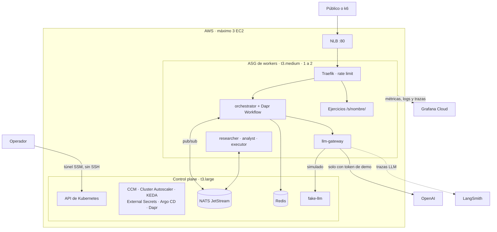
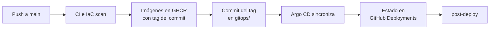

# Agentic Platform

[](https://github.com/Andresm98/03-agentic-platform-swe/actions/workflows/main.yml)
[](https://sonarcloud.io/project/overview?id=Andresm98_03-agentic-platform-swe)
[](LICENSE)

Laboratorio **efímero y reproducible** de una plataforma Kubernetes autogestionada (K3s sobre EC2) que ejecuta una flota de agentes de IA. Se levanta para un ensayo o una defensa pública, vive unas horas y se destruye con `terraform destroy`.

Los agentes son la carga que pone a prueba la plataforma: colas, reintentos, escalado y fallos parciales. Tienen una particularidad: cada llamada al modelo real cuesta dinero. Por eso una prueba de carga o un ataque se atiende con un LLM simulado y **no gasta tokens reales**.

> **Sin alta disponibilidad.** El cluster tiene un único control plane. Si ese nodo se pierde, se pierde el cluster y se recrea desde Git y Terraform. Es una decisión consciente para un laboratorio de coste mínimo, no un diseño de producción.

## Estado real

Actualizado el 2026-11-08. **El laboratorio todavía no se ha desplegado en AWS.** Solo se afirma lo que tiene evidencia en la [bitácora de despliegue](docs/bitacora.md) o en el [registro de validación](docs/validation-log.md).

| Área | Estado | Evidencia |
|---|---|---|
| Tests de las apps | ✅ Probado | Cobertura ≥ 80 % por servicio; 91,2 % en SonarCloud |
| Arquitectura de código | ✅ Probado | 27 contratos de `import-linter` y `mypy` estricto |
| Flota completa en `docker compose` | ✅ Probado | Tarea `completed` con 0 tokens reales |
| Reanudación tras matar el orquestador | ✅ Probado | La tarea termina sus 3 pasos |
| Ejercicio de ejemplo en `kind` | ✅ Probado | Rollout correcto con Pod Security `restricted` |
| Pipeline `main` en GitHub Actions | ✅ Probado | CI, escaneo IaC, 6 imágenes y promoción GitOps |
| Capa persistente de AWS | ✅ Desplegada | Terraform sin diferencias |
| Mirror de imágenes de plataforma | ✅ Probado | 6 imágenes copiadas con su digest y descargables sin login |
| Cluster local en k3d y pruebas k6 | ⏳ Sin probar | Los escenarios de demo aún no se han ejecutado |
| `lab.yml up`: EC2, K3s y Argo CD | ⏳ Sin probar | |
| Balanceo por NLB y autoscaling de nodos | ⏳ Sin probar | Exige ver un EC2 real unirse al cluster |
| Telemetría en Grafana Cloud | ⏳ Sin probar | Requiere el cluster en marcha |
| Modelo real de OpenAI y LangSmith | ⏳ Sin probar | |
| Flujo de ejercicios en la rama `stage` | ⏳ Sin probar | Probado solo por partes |

## Arquitectura



Más vistas (C4, red, secuencia de una tarea y cadena de elasticidad) en el [plan de implementación](docs/IMPLEMENTATION_PLAN.md#2-arquitectura-objetivo).

### Cómo se resuelve una tarea

1. El cliente envía `POST /tasks` y recibe `202` con un `task_id`.
2. El orquestador abre un **Dapr Workflow** y pide al modelo la siguiente acción. **El modelo decide el flujo**, con un máximo de 6 pasos.
3. Cada paso se delega a un agente por NATS JetStream y el resultado vuelve al workflow.
4. Si el pod muere, el workflow continúa desde el último paso guardado en Redis. Solo se repite la llamada al modelo que estaba en curso.
5. El estado se consulta con `GET /tasks/{id}`.

### La flota

| Servicio | Responsabilidad | Réplicas |
|---|---|---|
| `orchestrator` | API pública, admisión y Dapr Workflow | 1–4 |
| `researcher` | Consulta una base de conocimiento local | 0–3 |
| `analyst` | Puntuación determinista del resultado | 0–3 |
| `executor` | Trabajo de CPU de un catálogo cerrado | 1–8 |
| `llm-gateway` | Único servicio con la API key: modo, presupuesto, circuit breaker y telemetría | 2 |
| `fake-llm` | API compatible con OpenAI, determinista y con inyección de fallos | 1 |

## Decisiones clave

### Control del gasto en el modelo

| Barrera | Mecanismo | Tope |
|---|---|---|
| Admisión | El modo real exige `X-Demo-Token`. El tráfico público siempre va a `fake-llm` | Sin token, 0 tokens reales |
| Gateway | Reserva y concilia el gasto en NATS KV. Al agotarse, degrada a `fake-llm` | 3 USD |
| Proveedor | Proyecto dedicado de OpenAI | 5 USD |

Cada tarea admite como máximo 6 pasos, y las respuestas se limitan a 200–300 tokens.

### Elasticidad en dos niveles

| Nivel | Componente | Señal | Límite |
|---|---|---|---|
| Pods | KEDA y HPA | Profundidad de la cola JetStream y CPU | Réplicas por servicio (tabla anterior) |
| Nodos | Cluster Autoscaler | Pods en `Pending` | ASG de 1 a 2 workers |
| Tráfico | AWS CCM y NLB | Registro de los nodos | NodePort `30080` |

Un agente LLM pasa casi todo el tiempo esperando a la red, así que la CPU no refleja su carga. La cola sí.

### Entrega con GitOps



GitHub Actions no toca el cluster: solo escribe en Git. Todo lo despliega Argo CD (app-of-apps con sync-waves, `prune` y `selfHeal`). Las acciones se fijan por SHA, las imágenes por tag de commit o digest, y nunca se usa `latest`.

### Seguridad

- **Sin credenciales largas en CI:** GitHub entra en AWS por OIDC, con un rol por environment.
- **Sin SSH ni API server público:** el acceso es por AWS Systems Manager.
- **Secretos solo en SSM** (`SecureString`), sincronizados con External Secrets. Nunca en Git, en imágenes o en `user-data`.
- **Nodos:** IMDSv2 obligatorio y un rol IAM por controlador.
- **Contenedores:** distroless, sin root y con sistema de archivos de solo lectura donde aplica.
- **Red:** NetworkPolicy default-deny y mTLS entre agentes con Dapr.
- **Superficie pública:** solo `/tasks` y los ejercicios en `/s/<nombre>/`.
- **Coste:** AWS Budget, `cost-check` tras cada apagado y `lab-reaper`, que destruye el laboratorio pasadas 6 horas.

### Arquitectura del código

Cada servicio sigue Clean/Hexagonal, y CI impide que las dependencias apunten hacia fuera.

| Capa | Contenido |
|---|---|
| `domain/` | Python puro: entidades y políticas |
| `application/` | Casos de uso y puertos |
| `adapters/` | FastAPI, Dapr, OpenAI, NATS y telemetría |
| `bootstrap/` | Composition root con inyección de dependencias |

Detalles en [`apps/README.md`](apps/README.md).

## Interfaces

Solo el orquestador y los ejercicios son públicos. El resto se abre desde tu máquina, con el túnel activo:

```bash
make tunnel                      # en una terminal, y déjala abierta
export KUBECONFIG=.lab/kubeconfig # en otra
```

| Interfaz | Acceso | Muestra |
|---|---|---|
| API de tareas | `http://<nlb>/tasks` | Punto de entrada público |
| Ejercicios | `http://<nlb>/s/<nombre>/` | Contenedores de estudiantes |
| Argo CD | `kubectl -n argocd port-forward svc/argo-cd-argocd-server 8080:80` → <http://localhost:8080> | Estado de cada aplicación |
| Dapr Dashboard | `kubectl -n dapr-system port-forward svc/dapr-dashboard 8081:8080` → <http://localhost:8081> | Apps, componentes y configuración de la flota |
| Grafana Cloud | Tu stack | 6 dashboards organizados por las 4 Golden Signals |
| LangSmith | Proyecto `agentic-platform` | Llamadas al modelo: reales al 100 %, simuladas al 1 % |

Contraseña inicial de Argo CD (usuario `admin`):

```bash
kubectl -n argocd get secret argocd-initial-admin-secret -o jsonpath='{.data.password}' | base64 -d
```

## Ejercicios de estudiantes

Un estudiante puede publicar su propia aplicación en la plataforma, en cualquier lenguaje, con un Pull Request hacia la rama `stage`:

```
exercises/<tu-nombre>/     Copia de exercises/_ejemplo (Go), con Dockerfile y exercise.yaml
        │ Pull Request a stage, revisado por el instructor
        ▼
CI valida, construye, escanea y prueba en un cluster temporal
        │
        ▼
Argo CD lo despliega en el namespace stage → http://<nlb>/s/<tu-nombre>/
```

Hay un máximo de 3 ejercicios a la vez. Reciben tráfico público, pero no pueden salir a Internet, y corren con Pod Security `restricted` y cuota de recursos. La guía está en [`exercises/README.md`](exercises/README.md).

## Puesta en marcha

### En local, sin coste

Requiere Docker y Git Bash en Windows. Usa siempre `fake-llm`.

```bash
make compose-up
bash apps/compose/smoke.sh       # envía una tarea y comprueba que termina sin tokens reales
make test
make compose-down
```

`make local-up` crea además un cluster k3d con Argo CD, aunque ese perfil **aún no se ha probado**.

### En AWS

La [guía de configuración](docs/SETUP.md) explica, en orden, cada cuenta, token y permiso que hace falta. Con todo preparado:

```bash
gh workflow run lab.yml --ref main -f action=up     # pide tu aprobación dos veces
gh workflow run lab.yml --ref main -f action=down   # destruye y comprueba que no quede nada
```

`make up` y `make down` hacen lo mismo desde tu máquina, como respaldo.

### Herramientas

Git y Bash, GNU `make`, Docker, `kubectl`, Helm 4, k3d, Terraform ≥ 1.11, AWS CLI v2 con `session-manager-plugin`, `gh`, `jq`, `yq` y `uv`. Las versiones fijadas están en [`docs/versions.md`](docs/versions.md).

## Escenarios de demo

Cada escenario es un script con comprobaciones automáticas: `make demo N=<n>`. **Ninguno se ha ejecutado todavía contra un cluster.** La columna *Local* indica dónde podrá correr.

| # | Escenario | Qué comprueba | Local |
|---|---|---|---|
| 1 | Despliegue | Apps `Synced/Healthy` y respuesta 200 | Sí |
| 2 | Sync GitOps | Un commit llega a los pods | Sí |
| 3 | Self-healing | Réplica restaurada y drift revertido | Sí |
| 4 | Tráfico | Rampa k6, RPS y p95 | Sí |
| 5 | HPA | Más de 1 réplica | Sí |
| 6 | Pending | `FailedScheduling: Insufficient cpu` | Sí |
| 7 | Cluster Autoscaler | `TriggeredScaleUp` y `DesiredCapacity=2` | No |
| 8 | Join de K3s | Nodo `Ready` con `providerID` válido | No |
| 9 | Registro en el NLB | Target `healthy` | No |
| 10 | Distribución | Reparto por pod | Sí |
| 11 | Scale-down | Instancia terminada, Node y target eliminados | No |
| 12 | Grafana | Series recientes en la API | No |
| 13 | Ataque | `429`, ASG ≤ 2 y **0 tokens reales** | Sí |
| 14 | Caos del LLM | Circuito abierto y ninguna tarea perdida | Sí |
| 15 | Modelo real | Tokens reales con token de demo y degradación | No |

## Costes

Estimación con precios on-demand de `us-east-1`. Aún no se ha contrastado con una factura real.

| Concepto | Estimación |
|---|---|
| Laboratorio encendido | ~0,19–0,23 USD/h |
| Ensayo o defensa de ~3 h | ~0,7 USD |
| Capa persistente | < 0,05 USD/mes |
| GitHub Actions, GHCR y Grafana Cloud | 0, en planes gratuitos |
| Carga, ataque y caos con `fake-llm` | 0 |
| Modelo real | ≤ 5 USD |
| **Total del proyecto** (2 ensayos + defensa) | **≈ 3–5 USD** |

Nada de lo que corre en el cluster crea recursos de AWS: sin volúmenes EBS dinámicos, NAT ni Elastic IP.

## Desviaciones del brief original

| Brief | Implementación | Motivo |
|---|---|---|
| ingress-nginx | Traefik | ingress-nginx está retirado desde marzo de 2026 |
| Docker Hub | GHCR y mirror por digest | Sus límites de pull podrían bloquear el escalado en plena demo |
| Sin KEDA en el camino crítico | KEDA con cola y CPU | La CPU no refleja la carga de un agente LLM |
| Evitar componentes extra | Dapr y Redis | Orquestación durable, trazas automáticas y mTLS |
| Sin LLM externos | OpenAI solo en modo protegido | Demostrar un modelo real con gasto acotado |
| CD desde GitHub Actions | CD con Argo CD | GitOps puro, sin exponer el API server |

La justificación completa está en los [ADRs](docs/adrs/).

## Limitaciones conocidas

- Un único control plane; el plano de control de Dapr, NATS y Redis también tienen una sola réplica.
- Sin TLS en el NLB porque no hay dominio. El tráfico público viaja por HTTP.
- Los nodos tienen IP pública para evitar el coste de un NAT. Los Security Groups limitan la entrada.
- Las pruebas de carga usan `fake-llm`: validan la plataforma, no la calidad del modelo.
- Sonar analiza solo `apps/`; la infraestructura se revisa con Checkov, tflint y shellcheck.
- La URL del NLB cambia en cada despliegue.

## Estructura del repositorio

| Ruta | Contenido |
|---|---|
| [`infra/`](infra/) | Terraform (`bootstrap`, `modules`, `envs/lab`) y scripts de operación |
| [`kubernetes/`](kubernetes/) | Bootstrap de K3s y chart común `agent-service` |
| [`gitops/`](gitops/) | Lo que sincroniza Argo CD: plataforma, overlays, apps y ejercicios |
| [`apps/`](apps/) | Agentes, gateway, `fake-llm`, compose y pruebas k6 |
| [`exercises/`](exercises/) | Ejemplo y guía para estudiantes |
| [`observability/`](observability/) | Dashboards y Terraform de Grafana Cloud |
| [`scripts/`](scripts/) | Demos, perfil local y validador de ejercicios |
| [`.github/workflows/`](.github/workflows/) | CI, imágenes, promoción, ciclo de vida del laboratorio y ejercicios |

## Documentación

| Documento | Para qué sirve |
|---|---|
| [Guía de configuración](docs/SETUP.md) | Preparar cuentas, tokens y permisos |
| [Bitácora de despliegue](docs/bitacora.md) | Qué se ha hecho, comprobado y corregido |
| [Plan de implementación](docs/IMPLEMENTATION_PLAN.md) | Diseño completo y diagramas |
| [ADR-0001](docs/adrs/0001-plataforma-bootstrap-y-ciclo-de-vida.md) · [ADR-0002](docs/adrs/0002-identidad-credenciales-y-elasticidad.md) | Decisiones y su justificación |
| [Contratos](docs/CONTRACTS.md) | Nombres e interfaces entre capas |
| [Versiones](docs/versions.md) | Versiones fijadas |
| [Runbook](docs/runbook.md) | Diagnóstico por fase |
| [Registro de validación](docs/validation-log.md) | Evidencia de cada prueba |

## Licencia

[MIT](LICENSE) © Andresm98
