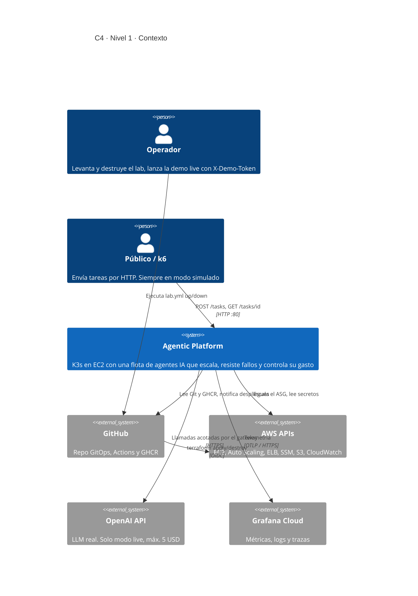
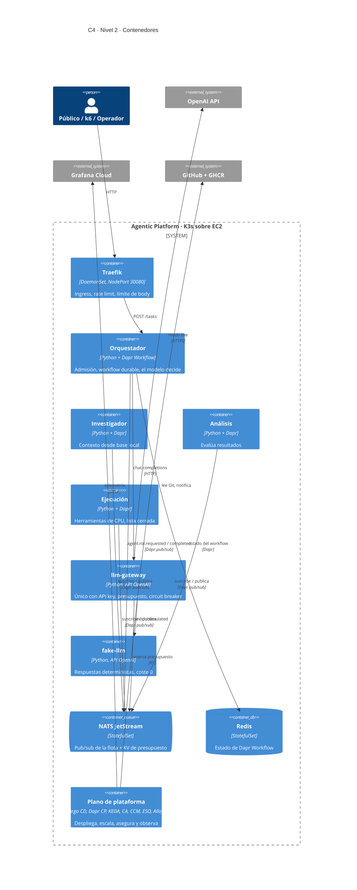
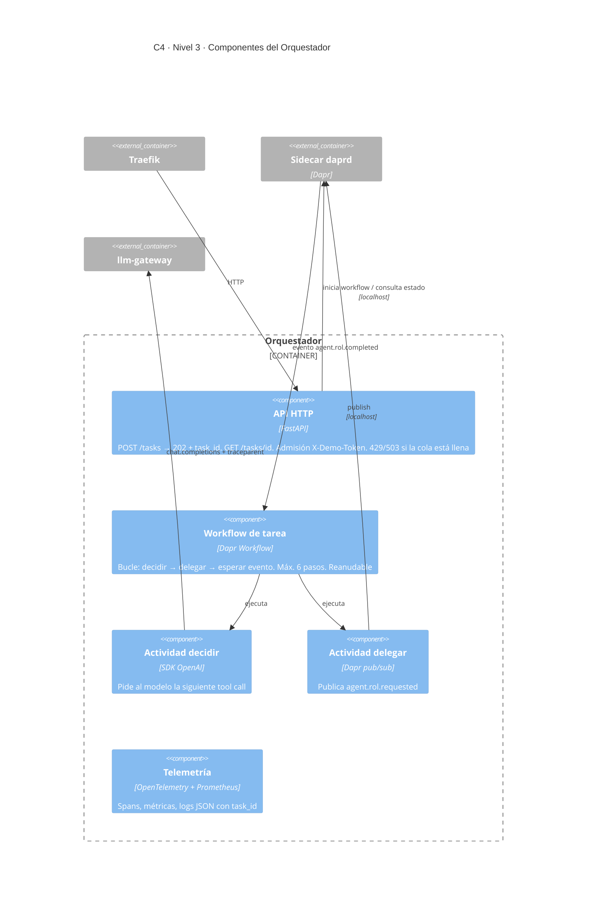
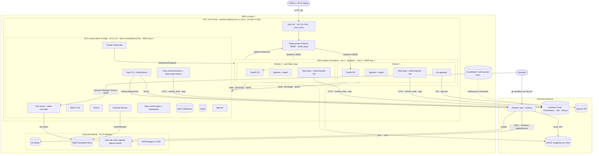
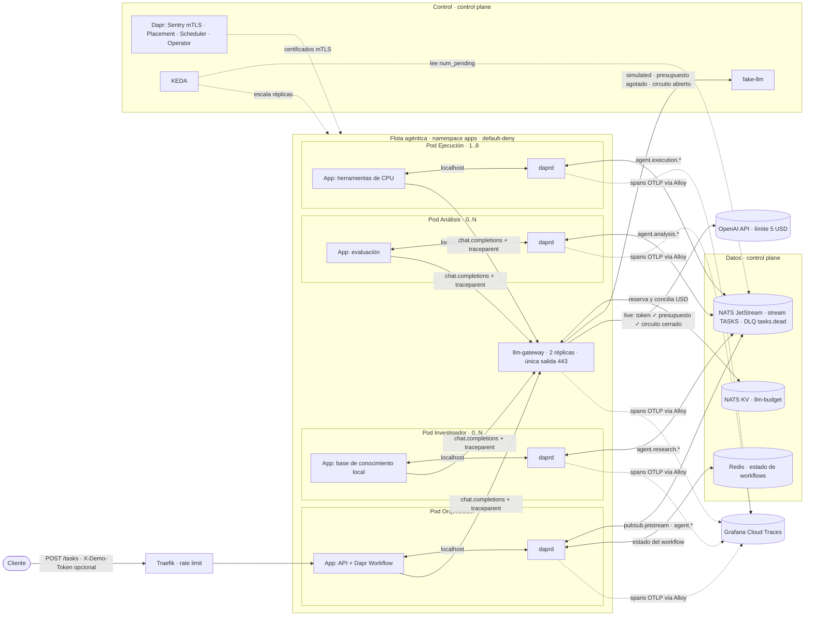
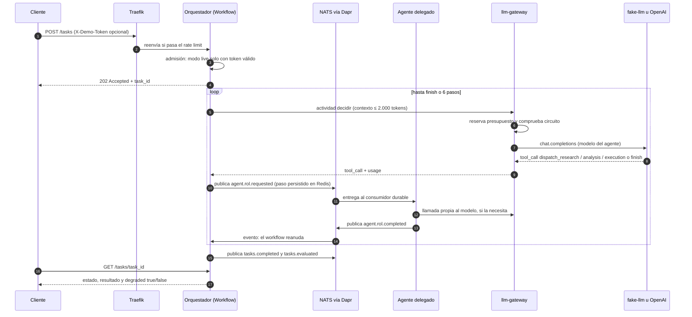
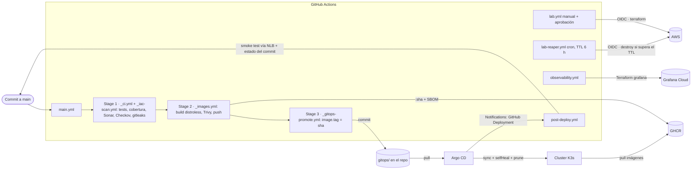
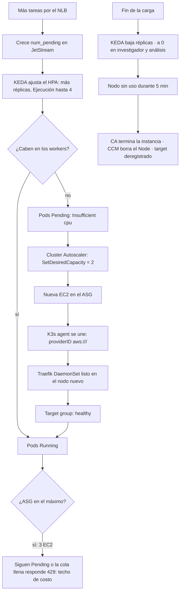

# Agentic Distributed Container Platform — Plan de implementación ajustado

> Estado: plan. Nada de lo descrito aquí está desplegado ni verificado todavía.
> Fecha: 2026-11-07 · Región objetivo: `us-east-1` · Cuenta AWS detectada: `972588015487` (usuario `terraform-user`)

ADRs: [0001 Plataforma, flota agéntica y ciclo de vida efímero](adrs/0001-plataforma-bootstrap-y-ciclo-de-vida.md) · [0002 Identidad, credenciales, elasticidad y resiliencia](adrs/0002-identidad-credenciales-y-elasticidad.md)

> **Modelo de operación:** el entorno AWS solo existe durante los ensayos y la defensa (unas horas) y se elimina con `terraform destroy` al terminar. Requisitos rectores: replicabilidad, elasticidad, portabilidad y **costo mínimo** (ver ADR-0001).

Este documento aterriza el brief original. Mantiene sus requisitos y corrige los puntos que, tal como estaban, harían fallar la implementación o la demo. Cada ajuste dice **qué** cambia y **por qué**.

---

## 0. Diagnóstico inicial

| Ítem | Estado | Acción |
|---|---|---|
| Repo | Vacío, **no es git** | `git init` + crear repo en GitHub (Argo CD necesita un remoto) |
| AWS CLI / credenciales | OK (`terraform-user`, us-east-1) | Validar permisos IAM suficientes (IAM, EC2, ELBv2, ASG, SSM, S3) |
| Terraform | 1.14.5 | OK |
| kubectl / Helm | 1.36.1 / 4.1.4 | Los charts deben probarse con Helm 4 (o fijar Helm 3.x en CI) |
| Docker | Instalado, daemon no respondió | Arrancar Docker Desktop |
| session-manager-plugin | **Falta** | Necesario para acceder al API server por túnel SSM |
| k6 | Falta | Usar la imagen `grafana/k6` fijada por versión (sin instalarlo localmente) |
| gh, jq, yq, uv | Faltan | Instalar (`winget`) o usar alternativas en contenedor |
| GitHub (repo + GHCR) / Grafana Cloud | Sin verificar | Prerrequisitos de la Fase 0 |

---

## 1. Ajustes críticos al brief

### 1.1 Sin ajustar, estos puntos rompen la implementación

1. **El nombre del nodo debe coincidir con el private DNS de EC2.** El AWS CCM busca la instancia por nombre de nodo. Se arranca K3s con `--node-name=$(IMDS local-hostname)` (`ip-10-0-x-y.ec2.internal`) y además con `--kubelet-arg=provider-id=aws:///<az>/<instance-id>`, así el `providerID` es correcto desde el primer momento. Cluster Autoscaler empareja nodos con instancias del ASG por `providerID`.
2. **El CCM tiene que existir antes que cualquier otra cosa.** Con `cloud-provider=external`, todos los nodos nacen con el taint `node.cloudprovider.kubernetes.io/uninitialized` y no se programa nada hasta que el CCM los inicializa. Se instala con el **helm-controller embebido de K3s** (`HelmChart` en `/var/lib/rancher/k3s/server/manifests/`, con `spec.bootstrap: true`). No se instala con Argo ni a mano.
3. **CCM y Flannel.** Hay que desactivar el route controller (`--configure-cloud-routes=false`) porque Flannel VXLAN gestiona las rutas. Se limitan los controladores a `cloud-node,cloud-node-lifecycle`. El NLB lo gestiona Terraform, no el service controller del CCM. `cloud-node-lifecycle` es el que borra el objeto `Node` cuando el CA termina la instancia, y lo necesitamos para el escenario 11.
4. **Tags `kubernetes.io/cluster/agentic-platform=owned`** en las instancias (también las que propaga el ASG), las subnets y los SGs. Sin ellos, el CCM no funciona.
5. **Labels de nodo.** El kubelet no puede ponerse a sí mismo labels `node-role.kubernetes.io/*` (NodeRestriction). Usamos `platform.io/role=worker` y `platform.io/pool=apps` con `--node-label`.
6. **Ubuntu 24.04 no trae AWS CLI.** El user-data debe instalar AWS CLI v2 en una versión fijada para leer el token de SSM. El agente SSM ya viene preinstalado (snap).
7. **Carrera del join token.** El control plane genera el token y lo publica en Parameter Store (`SecureString`). Los workers lo leen en un bucle con backoff y timeout. Así el token nunca pasa por el estado de Terraform. El control plane usa una **IP privada fija** (p. ej. `10.0.1.10`) que se pasa al user-data de los workers. No es un secreto.
8. **Terraform contra Cluster Autoscaler.** El CA cambia `desired_capacity`, así que el ASG lleva `lifecycle { ignore_changes = [desired_capacity] }`. Si no, cada `terraform apply` revierte el escalado.
9. **ASG.** Se suspende el proceso `AZRebalance` para que AWS no termine nodos por su cuenta. Nada de instance refresh que lance una cuarta instancia (respeta el límite de 3 EC2).
10. **CPU credits de t3.** Se fija `cpu_credits = "unlimited"`. En modo *standard*, cuando se agotan los créditos la CPU cae al 20 % de base y la demo de HPA deja de ser fiable.
11. **El trabajo CPU-intensivo en Python bloquea FastAPI.** Si el loop de CPU corre en el event loop o en un hilo (GIL), los probes fallan bajo carga y Kubernetes reinicia los pods justo en la demo. El agente de ejecución procesa en un `ProcessPoolExecutor(max_workers=1)` y mantiene el event loop libre para `/healthz`, `/readyz` y `/metrics`.
12. **NATS core no da reparto ni profundidad de cola.** Con pub/sub simple, cada réplica de un agente recibe cada mensaje, y la "queue depth" que pide el brief no existe. Se usa **JetStream** con consumidores *durable pull* (uno por agente), ack explícito, `ack_wait` mayor que la duración máxima y `max_deliver`. La profundidad de cola sale de `num_pending` vía `prometheus-nats-exporter`.

### 1.2 Decisiones de diseño necesarias que el brief no fija

13. **Dónde corre cada cosa** (clave para que la demo de Pending y del CA funcione):
    - Control plane (t3.large, 2 vCPU / 8 GiB) con el taint `CriticalAddonsOnly=true:NoExecute`. Allí corren CCM, Cluster Autoscaler, Argo CD, NATS (StatefulSet de 1 réplica con PV local-path, anclado al nodo fijo), metrics-server, CoreDNS, kube-state-metrics, Alloy (singleton y metrics) y External Secrets.
    - Workers (t3.medium): solo Traefik (DaemonSet), Alloy logs y node-exporter (DaemonSets), y las apps.
    - Motivo: si la plataforma ocupa los workers, el cálculo de Pending deja de ser predecible y el CA puede intentar mover componentes críticos.
14. **Credenciales del autoscaler (sin IRSA).** Se crea un rol dedicado `agentic-platform-cluster-autoscaler`. Su trust policy solo permite `sts:AssumeRole` desde el rol de instancia del control plane. El pod del CA corre anclado al control plane y monta un `AWS_CONFIG_FILE` con `role_arn` y `credential_source = Ec2InstanceMetadata`. La política se limita a `SetDesiredCapacity` y `TerminateInstanceInAutoScalingGroup` con condición `aws:ResourceTag/k8s.io/cluster-autoscaler/agentic-platform = owned`, más los `Describe*` necesarios. El CCM usa el mismo patrón con su propio rol.
15. **IMDS seguro.** IMDSv2 obligatorio en todas las instancias. `http_put_response_hop_limit = 2` solo en el control plane (los pods del CA y del CCM necesitan llegar a IMDS) y `= 1` en los workers, así los pods de apps no alcanzan las credenciales del nodo. Además, NetworkPolicy default-deny de egress en `apps`.
16. **Secretos en GitOps.** Los Secrets no pueden ir en claro en Git. **Decidido:** External Secrets Operator leyendo SSM Parameter Store, con un rol dedicado y el mismo patrón de AssumeRole. Así Argo gestiona `ExternalSecret`s y los valores viven en SSM. Alternativa mínima: un script que crea los Secrets desde SSM una sola vez, que es menos declarativo.
17. **NLB público con Security Group.** Se asocia un SG al NLB que admite `TCP 80` desde `0.0.0.0/0`, porque la demo es pública (`var.allowed_cidrs`, con valor por defecto `["0.0.0.0/0"]`). El SG de workers solo admite `30080` desde el SG del NLB. Se activa cross-zone load balancing. Deregistration delay de 30 s para que el scale-down sea rápido. Health check `HTTP /ping` sobre el puerto de tráfico, servido por Traefik (`ping.entryPoint=web`).
    - **Solo el orquestador es público.** Argo CD, Grafana y la API de Kubernetes nunca se exponen; se accede a ellos por port-forward sobre el túnel SSM.
    - **Protección ante abuso:** middleware `RateLimit` de Traefik por IP, tamaño máximo de body, validación estricta del payload y `complexity` acotado en el orquestador. El modo `live` del LLM nunca es accesible para el público (ADR-0002 §6).
    - **Costo acotado:** el tráfico público no puede subir el costo de cómputo, porque la elasticidad tiene techo (HPA 8, ASG 2). Ver ADR-0002.
18. **Traefik como DaemonSet + `externalTrafficPolicy: Local`.** El Traefik que trae K3s se desactiva (`--disable traefik`) y se instala el chart oficial vía Argo CD, con versión fijada. Así el ingress es el mismo en AWS y en k3d local, que también es portabilidad.
    - Escucha internamente en el puerto 8000 (non-root, sin `NET_BIND_SERVICE`) y se publica en el NodePort 30080.
    - Las rutas usan el recurso estándar `Ingress` (`ingressClassName: traefik`) y **no** los CRDs `IngressRoute`, para no quedar atados a Traefik. El middleware se referencia por annotation.
    - Un worker nuevo solo pasa a *healthy* en el NLB cuando su pod de Traefik está listo. Eso hace observable y verificable el escenario 9, y además conserva la IP del cliente.
    - Traefik expone métricas Prometheus por entrypoint y por servicio, que alimentan las 4 Golden Signals en el borde.
19. **Acceso al cluster sin SSH ni 6443 público.** Se abre un túnel SSM `AWS-StartPortForwardingSessionToRemoteHost` hacia `127.0.0.1:6443` del control plane. Se descarga el kubeconfig vía `ssm send-command` y se reescribe a `https://127.0.0.1:6443` (el certificado de K3s ya incluye `127.0.0.1`). Script: `infra/scripts/tunnel.sh`.
20. **El estado de Terraform es sensible.** Backend S3 cifrado, con versionado y `use_lockfile = true` (sin DynamoDB). Lo crea un mini-stack `infra/terraform/bootstrap`.
21. **AMI fija.** Se resuelve la AMI de Ubuntu 24.04 una vez y se fija en una variable, o se usa `ignore_changes = [ami, user_data]` en el control plane. Un cambio de AMI recrearía el control plane y **se perdería el datastore** del cluster (single-CP, sin HA).
22. **Reutilización de IPs y node-password de K3s.** Si un worker nuevo recibe la IP (y por tanto el nombre) de uno eliminado cuyo `Node` no se borró, K3s rechaza el join con *node password rejected*. Lo mitigan `cloud-node-lifecycle` y un check en el script de demo de scale-down.

### 1.3 Desviaciones del brief y riesgos (decididos el 2026-11-07)

- **Traefik en lugar de ingress-nginx.** Desviación consciente del brief: ingress-nginx está retirado (sin parches de seguridad desde marzo de 2026). La ruta Internet → NLB → worker:30080 → ingress → Service → Pod no cambia. Se documenta en el README.
- **Free tier de Grafana Cloud.** Unas 10k series activas. El chart `k8s-monitoring` por defecto puede superarlas, así que lleva allowlists de métricas desde el primer día.
- **Métricas del ASG vía CloudWatch.** Se activa `enabled_metrics` en el ASG (las métricas de grupo del ASG no tienen costo). Grafana Cloud consulta CloudWatch con un **datasource** que asume un rol IAM cross-account con external ID, creado por Terraform. El datasource consulta al abrir el dashboard, sin metric streams ni scraping continuo, así que el costo es casi nulo. Se complementa con las métricas propias del CA (`cluster_autoscaler_*`). No se usa Container Insights ni el EC2 detailed monitoring, que tienen costo.
- **4 Golden Signals** (latencia, tráfico, errores, saturación) en dos niveles:
  - **Borde:** métricas de Traefik.
  - **Servicio:** métricas de cada app, más la profundidad de la cola de NATS como saturación de cada agente, y el consumo de tokens por modo.
- **"Alloy como DaemonSet".** `k8s-monitoring` despliega Alloy en tres formas: logs como DaemonSet, eventos como singleton y métricas en clúster. Cumple el requisito y se documenta así.
- **GitHub Container Registry (GHCR) en lugar de Docker Hub.** Es una desviación consciente del brief, que pedía Docker Hub con `DOCKERHUB_USERNAME`/`DOCKERHUB_TOKEN`. Motivo: los límites de pulls anónimos de Docker Hub por IP podrían bloquear el scale-up en plena demo.
  - **Imágenes propias:** `ghcr.io/<owner>/agentic-platform/{orchestrator,researcher,analyst,executor,llm-gateway,fake-llm}:<git-sha>`, como paquetes **públicos**. Los nodos las descargan sin credenciales ni `imagePullSecrets`.
  - **Push desde CI:** con `GITHUB_TOKEN` (`packages: write`). No hacen falta secretos adicionales en GitHub.
  - **Imágenes de plataforma que solo existen en `docker.io`** (Traefik, NATS, Alloy…): el workflow `mirror-images.yml` las copia con `crane copy` **por digest** a `ghcr.io/<owner>/agentic-platform/mirror/*`, a partir de una lista versionada (`platform-images.lock`). Los values de los charts apuntan al mirror. Docker Hub solo se toca desde CI, nunca desde los nodos.
  - **Imágenes de sistema de K3s** (coredns, local-path, metrics-server, pause): se cargan con el tarball `k3s-airgap-images-amd64.tar.zst` de los releases de K3s en GitHub, colocado en `/var/lib/rancher/k3s/agent/images/`.
  - **Resto de imágenes:** se prefieren registries no limitados (`registry.k8s.io`, `quay.io`, `ghcr.io`).
  - **Resultado:** el día de la demo los nodos dependen solo de GitHub (repo, releases y GHCR), `registry.k8s.io` y `quay.io`.
- **Repo público.** Sin deploy key para Argo CD. Obliga a `gitleaks` en pre-commit y en CI, y a revisar que ningún `tfvars` ni kubeconfig llegue a Git.

---

## 2. Arquitectura objetivo

Los diagramas usan Mermaid. GitHub los renderiza; en VS Code hace falta una extensión de vista previa de Mermaid. Los diagramas C4 usan la sintaxis C4 de Mermaid, que es experimental: si alguno no se renderiza bien, las §2.B y §2.C contienen la misma información en formato flowchart.

### 2.A Modelo C4

**Nivel 1 — Contexto.** Quién usa el sistema y de qué servicios externos depende.



**Nivel 2 — Contenedores.** Las piezas desplegables dentro del sistema y cómo se hablan.



Investigador, análisis y ejecución también llaman a `llm-gateway`; se omite en el diagrama por legibilidad.

**Nivel 3 — Componentes del orquestador.** El contenedor que coordina la flota.



### 2.B Plataforma: infraestructura, red y ubicación de pods



### 2.C Plataforma agéntica: runtime, mensajería y control del LLM



### 2.D Secuencia de una tarea



Si el pod del orquestador muere durante el bucle, otra réplica reanuda el workflow desde el último paso persistido.

### 2.E CI/CD y GitOps: flujos de ida y vuelta



Ningún workflow aplica nada al cluster: el cluster solo cambia porque Argo CD lee Git.

### 2.F Cadena de elasticidad: subida y bajada



**Rutas clave:**
- **Petición:** Internet → NLB:80 → worker:30080 → Traefik → Service `orchestrator` → Pod.
- **Evento:** `tasks.created` → orquestador ⇄ `agent.<rol>.requested|completed` (investigador, análisis, ejecución) → `tasks.completed` → `tasks.evaluated`, correlacionado por `task_id`.
- **Llamadas al modelo:** toda llamada pasa por `llm-gateway`.

### 2.1 Reglas de Security Groups

| Origen → Destino | Puerto | Motivo |
|---|---|---|
| 0.0.0.0/0 (`allowed_cidrs`) → NLB SG | TCP 80 | Demo pública |
| NLB SG → workers | TCP 30080 | NodePort de Traefik y health check |
| workers → CP | TCP 6443 (no se abre 9345: no hay supervisor HA) | API de K3s |
| nodos ↔ nodos | UDP 8472 | Flannel VXLAN |
| nodos ↔ nodos | TCP 10250 | kubelet (metrics-server, logs y exec) |
| nodos ↔ nodos | TCP 9100 | node-exporter en `hostNetwork` (scraping de Alloy desde el CP) |
| todos → 0.0.0.0/0 | 443 egress | SSM, GitHub (GHCR, releases, repo), registry.k8s.io, quay.io, Grafana Cloud, AWS APIs |
| Público → nodos | **nada** | Sin SSH; acceso por Session Manager |

### 2.2 Presupuesto de capacidad (para la demo de Pending y del CA)

Allocatable aproximado de un t3.medium: unos 1.9 vCPU y 3.3 GiB.

| Pod (por worker) | CPU request |
|---|---|
| Traefik | 100m |
| alloy-logs + node-exporter | ~100m |
| sidecar `daprd` (por cada réplica de la flota) | ~25m c/u (se calibra) |
| llm-gateway ×2 | 2×100m |
| orquestador ×1–N | 100m c/u |
| investigador, análisis (0–N, escalan a cero) | 100m c/u |
| **agente de ejecución** | **500m** request / 1000m limit |

- Los agentes LLM piden poca CPU porque pasan casi todo el tiempo esperando al modelo. El **agente de ejecución** es el que llena los nodos.
- Worker 1: caben unos 2 agentes de ejecución. Worker 2: unos 3. Total con el ASG al máximo: unos 5.
- Con KEDA en `max 4`, la carga produce la secuencia: Pending en el worker 1 → CA lanza el worker 2 → todos se programan. Con `max 8` el agente de ejecución acaparaba la CPU y dejaba sin sitio al análisis (validation-log, escenarios en AWS).
- Los valores exactos se calibran en la Fase H midiendo el allocatable real (`kubectl describe node`).

ScaledObject del agente de ejecución (KEDA): min 1, max 8, triggers CPU al 60 % del request (300m) y `num_pending` de su consumidor JetStream. `behavior.scaleUp` de +2 pods cada 30 s (visible en la demo). `scaleDown.stabilizationWindowSeconds: 120` en laboratorio.
Cluster Autoscaler: `--scale-down-unneeded-time=5m`, `--scale-down-delay-after-add=5m`, `--skip-nodes-with-local-storage=false`, `--expander=least-waste`, descubrimiento con `--node-group-auto-discovery=asg:tag=k8s.io/cluster-autoscaler/enabled,k8s.io/cluster-autoscaler/agentic-platform`.

---

## 3. Versiones a fijar

En la Fase 0 se congelan en [`versions.md`](versions.md). Regla: **K3s, AWS CCM y Cluster Autoscaler comparten la misma minor de Kubernetes.**

| Componente | Candidato | Nota |
|---|---|---|
| K3s | `v1.35.10+k3s1` (ver `docs/versions.md`) | Verificar con `curl -sfL https://update.k3s.io/v1-release/channels` |
| AWS CCM (chart `aws-cloud-controller-manager`) | chart `0.0.12` / imagen `v1.35.2` | Misma minor |
| Cluster Autoscaler (chart `cluster-autoscaler`) | chart `9.59.0` / imagen `v1.35.3` | Misma minor |
| Terraform AWS provider | `~> 6.x` fijado exacto en `.terraform.lock.hcl` | |
| Argo CD (chart `argo-cd`) | 3.x | |
| NATS (chart `nats`) | 1.x (NATS 2.11/2.12) | JetStream + exporter |
| Traefik (chart `traefik`) | 3.x estable (chart 3x.x) | El Traefik de K3s se desactiva; se instala vía Argo CD |
| k3d (perfil local) | 5.x | Portabilidad y ensayos sin costo |
| External Secrets | 0.x / 1.x estable | |
| Grafana `k8s-monitoring` | 3.x | |
| KEDA (chart `keda`) | 2.x estable | Escalador `nats-jetstream` + CPU; corre en el CP |
| Dapr (chart `dapr`) + Dashboard | 1.x estable (imágenes desde `ghcr.io/dapr`, a verificar) | Sin HA; SDK `dapr-ext-workflow` para Python. Evaluar Dapr Agents en la Fase 0 |
| Redis (estado de workflows) | 7.x / 8.x fijado por digest | 1 réplica en el CP, PV local-path. Confirmar en la Fase 0 que es un actor state store válido |
| Imagen runtime | `gcr.io/distroless/python3-debian12:nonroot` por digest | Builder `python:3.X-slim-bookworm` con **la misma minor** que la distroless |
| SDK `openai` (Python) | versión fijada en `uv.lock` | Agentes → `llm-gateway` (API compatible con OpenAI) |
| k6 | `grafana/k6:<1.x>` | |
| GitHub Actions | fijadas por **commit SHA** | Supply chain |

---

## 4. Estructura del repositorio

```
.
├── README.md                      # Quickstart, arquitectura, demos, costes, teardown
├── Makefile                       # up / down / tunnel / demo-N / validate
├── docs/
│   ├── IMPLEMENTATION_PLAN.md     # este documento
│   ├── versions.md
│   ├── architecture.md            # diagramas mermaid (red, flujo eventos, CI/CD, autoscaling)
│   ├── runbook.md                 # troubleshooting por fase
│   └── validation-log.md          # evidencia real por fase (comandos + salida); nada se marca OK sin ella
├── infra/
│   ├── terraform/
│   │   ├── bootstrap/             # bucket S3 de estado
│   │   ├── modules/{network,iam,control-plane,workers,nlb,observability-aws}/
│   │   └── envs/lab/              # main.tf, variables.tf, terraform.tfvars.example, backend.tf
│   │   └── templates/{server-userdata.sh.tftpl,agent-userdata.sh.tftpl}
│   └── scripts/{tunnel.sh,get-kubeconfig.sh,wait-for-nodes.sh}
├── kubernetes/
│   ├── bootstrap/                 # HelmChart de K3s: aws-ccm (bootstrap:true), argo-cd, root-app
│   └── charts/agent-service/      # chart único reutilizado por agentes, gateway y fake-llm (Deployment, ScaledObject, PDB, NetPol, ExternalSecret)
├── gitops/
│   ├── root-app.yaml              # app-of-apps
│   ├── platform/                  # Applications + values: cluster-autoscaler, keda, traefik, nats, eso, k8s-monitoring
│   ├── clusters/{aws-lab,local-k3d}/  # overlays por cluster (portabilidad): solo cambian values específicos
│   └── apps/                      # Applications + values-<servicio>.yaml (image.tag = SHA); LLM_GLOBAL_MODE aquí
├── apps/
│   ├── common/agentlib/           # NATS (reconexión, KV), bucle de agente con tool calls, métricas, logging JSON, health
│   ├── agents/{orchestrator,researcher,analyst,executor}/   # cada uno: app/, tests/, Dockerfile distroless, pyproject.toml
│   ├── llm-gateway/               # API compatible con OpenAI: enrutado live/fake, presupuesto en NATS KV, circuit breaker
│   ├── fake-llm/                  # API compatible con OpenAI determinista: guiones por rol, latencia y fallos configurables
│   ├── docker-compose.yml         # NATS + gateway + fake-llm + 4 agentes para pruebas locales e2e
│   └── loadgen/k6/                # smoke, ramp, spike, soak, attack (abuso), chaos
├── observability/
│   ├── dashboards/{infrastructure,kubernetes,application,autoscaling,messaging}.json
│   └── terraform/                 # provider grafana: dashboards + datasource CloudWatch (aplicado por observability.yml)
├── scripts/demos/01-..12-*.sh     # escenarios automatizados con asserts
└── .github/workflows/{main.yml,_ci.yml,_iac-scan.yml,_images.yml,_gitops-promote.yml,mirror-images.yml,lab.yml,lab-reaper.yml,observability.yml,post-deploy.yml}  # ver ADR-0001 §2
```

Decisiones:
- **Un chart, seis releases.** `agent-service` se instala para cada agente, el gateway y `fake-llm`, con values distintos y cada uno como su propia Argo Application. Los servicios se despliegan de forma independiente sin duplicar plantillas.
- **`agentlib` compartida.** El contexto de build es `apps/` y cada imagen copia solo `common/` y su servicio. Son seis imágenes independientes, todas distroless.

---

## 5. Diseño de las aplicaciones

La flota y sus garantías están en [ADR-0001 §3](adrs/0001-plataforma-bootstrap-y-ciclo-de-vida.md) y [ADR-0002 §6](adrs/0002-identidad-credenciales-y-elasticidad.md). Correspondencia con el brief: planner → **orquestador**, executor → **agente de ejecución**, evaluator → **agente de análisis**.

| | Orquestador | Investigador | Análisis | Ejecución |
|---|---|---|---|---|
| Entrada | `POST /tasks` (202 + `task_id`), `GET /tasks/{id}` (NATS KV); eventos `agent.*.completed` | `agent.research.requested` | `agent.analysis.requested` | `agent.execution.requested` |
| Salida | `tasks.created`, `agent.<rol>.requested`, `tasks.completed`, `tasks.evaluated` (vía análisis) | `agent.research.completed` | `agent.analysis.completed` | `agent.execution.completed` |
| Decide el modelo | plan y delegación (*tool calls*) | qué contexto recuperar | evaluación del resultado | qué herramienta ejecutar y con qué parámetros |
| Trabajo propio | admisión, `X-Demo-Token` → modo, límite de pasos por tarea | consulta a la base de conocimiento local | puntuación determinista | CPU real en un proceso aparte (`WORK_DURATION_MS` / `complexity` acotado) |
| Escalado | KEDA (cola) 1–N | KEDA (cola) **0**–N | KEDA (cola) **0**–N | KEDA CPU 60 % + cola, 1–8 |

Servicios de soporte:

| | `llm-gateway` | `fake-llm` |
|---|---|---|
| API | `POST /v1/chat/completions` (compatible con OpenAI) | la misma |
| Responsabilidad | Enrutado `live`/`simulated`, presupuesto global en NATS KV, límite por tarea, circuit breaker, timeouts y reintentos, métricas de tokens. Es el **único** con la API key y con salida 443. | Respuestas deterministas por rol (incluye *tool calls*), latencia lognormal, inyección de 429/5xx/timeouts, `usage` coherente |
| Réplicas / ubicación | 2 fijas en workers, PDB | 1–2 en el control plane (simula una dependencia externa) |

Comunes a todos los servicios:
- `/healthz` (liveness: proceso vivo), `/readyz` (readiness: conectado a NATS y stream disponible) y `/metrics`.
- Métricas: `http_request_duration_seconds`, `tasks_processed_total{status}`, `task_processing_seconds`, `task_e2e_latency_seconds`, `agent_steps_total{agent}`, `llm_requests_total{agent,mode,model,outcome}`, `llm_tokens_total{agent,mode,direction}`, `llm_budget_remaining`, `llm_circuit_state` y `tasks_shed_total`.
- **Backpressure:** stream con `max_msgs`/`max_bytes` y `discard=new`; con la cola llena, el orquestador responde `429` o `503` con `Retry-After`.
- **Idempotencia:** `task_id` como `Nats-Msg-Id`; DLQ en `tasks.dead`.
- NATS: `max_reconnect_attempts=-1`, callbacks de desconexión que ponen `readyz` en no listo, reintento al publicar, `ack`/`nak` con delay y `term` cuando se supera `max_deliver`.
- Logs JSON con `task_id` en cada línea.
- Apagado ordenado: drenar el consumidor ante SIGTERM y `terminationGracePeriodSeconds` mayor que la duración máxima de una tarea.
- Contenedor non-root (UID 10001), `readOnlyRootFilesystem`, `drop: [ALL]`, `seccompProfile: RuntimeDefault`.

Stream JetStream `TASKS` (subjects `tasks.>` y `agent.>`, file storage, `max_age` 24 h, réplicas 1, con límites) y buckets KV `task-state` y `llm-budget`. Los crea el orquestador de forma idempotente al arrancar, o un Job de Argo en sync-wave. NATS con un usuario por servicio y permisos por subject.

---

## 6. Plan por fases

Cada fase termina con: **validación → registro en `docs/validation-log.md` → corrección de errores → siguiente fase**. Ninguna fase se marca como completada sin evidencia real.

### Fase 0 — Prerrequisitos y trabajo local (sin coste AWS)
- `git init`, `.gitignore` (tfstate, `*.tfvars`, kubeconfig, `.env`) y repo **público** en GitHub. Pre-commit con `gitleaks`, `terraform fmt` y `ruff`.
- **Capa persistente** (ADR-0001): bucket S3 de estado, AWS Budget con alertas y parámetros SSM de secretos (`infra/scripts/seed-secrets.sh`). El único secreto externo es el token de Grafana Cloud. Esta capa **no** se destruye con el laboratorio y su costo es de céntimos al mes.
- Instalar `session-manager-plugin`, `gh`, `jq`, `yq` y `uv`. Arrancar Docker.
- **GitHub como plano de orquestación** (ADR-0001 §2):
  - El stack `bootstrap` crea el proveedor OIDC y `role/agentic-github-actions` con su permissions boundary.
  - En el repo: environments `lab` (con tu aprobación) y `observability`; variable `LAB_TTL_HOURS=6`.
  - GitHub App para Argo CD Notifications (`Deployments` y `Commit statuses`: write), con sus credenciales en SSM.
  - Proyecto OpenAI dedicado con **límite de 5 USD** y su API key en SSM.
- Cuentas: GHCR no necesita cuenta aparte; usa el repo de GitHub. Stack de Grafana Cloud con un token de Alloy (`metrics:write`, `logs:write`).
- Congelar versiones en `docs/versions.md`.
- **Se adelanta la Fase E local:** apps + tests + `docker-compose` + k6 contra compose. Desacopla el desarrollo del coste de AWS.
- **Perfil local k3d** (`make local-up`): Argo CD + `gitops/clusters/local-k3d` despliegan Traefik, NATS y las apps con **los mismos charts** que en AWS. Sirve para desarrollar y ensayar los escenarios 1–6 y 10 sin costo, y demuestra la portabilidad.
- **Todo el desarrollo con `fake-llm`** (`LLM_GLOBAL_MODE=simulated`). Un único test de contrato `live`, manual y con presupuesto mínimo, valida que `fake-llm` y la API real de OpenAI devuelven la misma forma de respuesta.
- ✅ Criterios: `pytest` en verde. Con `docker compose up`, una tarea recorre orquestador → investigador/análisis/ejecución → orquestador (`task_id` visible en todos los logs) con **0 tokens `live`**. En k3d, las Applications quedan `Synced/Healthy` y KEDA escala con k6.

### Fase A — Terraform e infraestructura AWS
- `default_tags` en el provider (`Project=agentic-platform`, `Lifecycle=ephemeral`, `Owner`). Módulos `network` (VPC, 2 AZ, subnets públicas, IGW), `iam` (roles de CP, worker, CA, CCM y ESO, más instance profiles), `control-plane`, `workers` (launch template + ASG 1/1/2 con tags del CA y de cluster, `AZRebalance` suspendido, `enabled_metrics`) y `nlb` (NLB + SG + TG instance:30080 + listener 80 + `aws_autoscaling_traffic_source_attachment`).
- Validación local: `terraform fmt -check`, `validate`, `tflint` y `checkov`/`trivy config`.
- ✅ Criterios: `terraform apply` ok; las 2 instancias aparecen `Online` en SSM Fleet Manager; puertos 22 y 6443 cerrados desde Internet (comprobado con `nc` desde la laptop); el TG existe (targets *unhealthy* todavía, es lo esperado).

### Fase B — K3s
- `server-userdata`: AWS CLI → K3s server en versión fijada (`--disable traefik,servicelb`, `--disable-cloud-controller`, `--kubelet-arg=cloud-provider=external`, `--kubelet-arg=provider-id=…`, `--node-name=<private-dns>`, `--node-taint CriticalAddonsOnly=true:NoExecute`, `--tls-san 127.0.0.1`, `--write-kubeconfig-mode 0600`) → `put-parameter` del token → copia de los manifests de bootstrap (CCM).
- `agent-userdata`: IMDSv2 → espera del token en SSM → K3s agent con `--node-label`, provider-id y node-name.
- Ambos descargan de los releases de GitHub el binario de K3s y `k3s-airgap-images-amd64.tar.zst` (versión fijada, verificados con `sha256sum-amd64.txt`) y colocan el tarball en `/var/lib/rancher/k3s/agent/images/`. Así, las imágenes de sistema no dependen de Docker Hub (§1.3).
- Idempotencia: guard por fichero de estado y `systemctl is-active`. Reejecutable con `cloud-init clean && cloud-init init`.
- ✅ Criterios: `kubectl get nodes -o wide` muestra 2 nodos `Ready` a través del túnel SSM; `spec.providerID` empieza por `aws:///`; reinstalar con user-data idempotente no rompe nada.

### Fase C — AWS CCM, Argo CD y Cluster Autoscaler (**reordenada**)
- El CCM llega en la Fase B (HelmChart bootstrap). Aquí se verifica: taint `uninitialized` eliminado y labels `topology.kubernetes.io/zone` presentes.
- **Argo CD se instala aquí y no en la Fase G** (HelmChart de K3s + `root-app`). Motivo: si se instalan el CA, ingress, NATS, etc. a mano con `helm install` y luego se intentan adoptar desde Argo, hay que repetir trabajo y quedan restos (secrets de release de Helm). Desde este momento **todo** lo que va al cluster entra por Git.
- Cluster Autoscaler vía `gitops/platform`, anclado al CP, con el rol dedicado vía `AWS_CONFIG_FILE`.
- ✅ Criterios: los logs del CA muestran el ASG descubierto con `min=1 max=2`; `kubectl -n kube-system get cm cluster-autoscaler-status`. Prueba de humo: un Deployment `pause` con requests altos provoca scale-up y un nodo nuevo `Ready` (**primera evidencia real**, registrada en el log).

### Fase D — NLB y Traefik
- Traefik como DaemonSet en workers: entrypoint `web` en 8000 publicado en el NodePort 30080, `externalTrafficPolicy: Local`, `ping` en `web`, métricas Prometheus y middlewares `RateLimit` y `Buffering` (límite de body). Ingress estándar de prueba (`/echo`).
- ✅ Criterios: TG con targets `healthy` (`aws elbv2 describe-target-health`); `curl http://<nlb-dns>/echo` devuelve 200 desde una red externa; ráfaga por encima del límite → `429`; tras escalar a 2 workers, ambos aparecen healthy.

### Fase E — Agentes y NATS en el cluster
- NATS JetStream (StatefulSet 1 réplica, PV local-path en el CP, exporter activado, annotation `Prune=false` en el PVC, usuarios por servicio). KEDA en el CP. `fake-llm`, `llm-gateway` y los 4 agentes vía Argo, con imágenes publicadas por CI (nunca `latest`). `LLM_GLOBAL_MODE=simulated` hasta la Fase H.
- NetworkPolicies: default-deny ingress y egress en `apps`. Se permite: DNS a kube-system, agentes → `nats:4222`, agentes → `llm-gateway`, `traefik → orchestrator:8000`, `alloy → *:metrics`, `llm-gateway → fake-llm` y **solo `llm-gateway` → 0.0.0.0/0:443**, excepto IMDS y las redes privadas.
- ✅ Criterios: `POST /tasks` vía NLB y el `task_id` aparece en los logs de todos los agentes. `nats stream info TASKS` coherente. Desde un pod de agente: `169.254.169.254` y `api.openai.com` dan **timeout**. KEDA escala investigador y análisis desde cero al llegar trabajo y los devuelve a cero en reposo.

### Fase F — GitHub Actions + GHCR
- **Modelo de referencia** (ADR-0001 §2): `main.yml` orquesta los reutilizables `_ci.yml` → `_iac-scan.yml` → `_images.yml` → `_gitops-promote.yml` por etapas con `needs`. Las acciones se fijan por SHA, sin `secrets: inherit` ni `:latest`, y se hace un solo build que se escanea y se publica.
- Contenido de las etapas: matriz por servicio con filtros de path. Pasos: checkout → `ruff` + `pytest` → static (`hadolint`, `helm lint`, `kubeconform`, `terraform validate`) → build (buildx, cache GHA, label `org.opencontainers.image.source` que enlaza el paquete al repo) → Trivy (fallo en CRITICAL) → login en `ghcr.io` con `GITHUB_TOKEN` (`packages: write`) → push `:<git-sha>` → `yq` sobre `gitops/apps/values-<svc>.yaml` → commit con `GITHUB_TOKEN` (`contents: write`). El commit hecho con `GITHUB_TOKEN` no redispara workflows, así que no hay bucle.
- `mirror-images.yml` (manual y al cambiar `platform-images.lock`): `crane copy` por digest de las imágenes de plataforma de `docker.io` a `ghcr.io/<owner>/agentic-platform/mirror/*`.
- **Paso manual único:** los paquetes de GHCR nacen **privados**. Tras el primer push, cada paquete (3 apps + mirrors) se cambia a *Public* en *Package settings*. Se verifica con `docker pull` anónimo.
- `lab.yml` (manual, `up|down`, environment `lab`, concurrency `lab`): `terraform apply`/`destroy` vía OIDC + `cost-check.sh`. `lab-reaper.yml` (cron horario) destruye el lab si supera `LAB_TTL_HOURS`. `observability.yml` aplica dashboards y datasource de Grafana.
- `post-deploy.yml` (`on: deployment_status`, creado por Argo CD Notifications vía la GitHub App): smoke tests de caja negra contra el NLB y estado del commit.
- Concurrency group para evitar carreras al actualizar los values. Push solo en `main`; en PRs solo build y scan.
- ✅ Criterios: un push cambia el tag en Git y Argo sincroniza el nuevo SHA (escenario 2), visible en el historial de Argo.

### Fase G — Endurecimiento de Helm y Argo CD
- El chart `agent-service` completo: probes de startup, liveness y readiness; RollingUpdate `maxSurge 1 / maxUnavailable 0`; ServiceAccount con `automountServiceAccountToken: false`; PDB; HPA; NetworkPolicy; ConfigMap; ExternalSecret.
- Argo: `automated: {prune: true, selfHeal: true}`, `syncOptions: [CreateNamespace=true, ServerSideApply=true]` y sync-waves (ESO → NATS → apps).
- **Qué implica prune** (se documenta en el README): borrar un fichero en Git borra el recurso en el cluster; los PVC de NATS llevan `Prune=false`. Con selfHeal, cualquier `kubectl edit` manual se revierte en segundos, así que las demos de cambio se hacen siempre por Git.
- ✅ Criterios: `helm lint` + `kubeconform` en CI; las Applications `Synced/Healthy`; editar a mano una réplica se revierte (evidencia).

### Fase H — Pruebas de elasticidad, resiliencia y autoscaling de nodos
- k6 en Docker desde la laptop (rampa → meseta → caída), **siempre contra `fake-llm`**. Se calibran los requests con el allocatable real.
- **Prueba de ataque** (escenario 13): ráfagas, payloads grandes y `X-Demo-Token` falso. Se espera `429` en el borde, `tasks_shed_total` creciendo, ASG ≤ 2 y `increase(llm_tokens_total{mode="live"}) == 0`.
- **Prueba de caos** (escenario 14): `fake-llm` con 30 % de 5xx y latencia alta → circuito abierto → reintentos o DLQ, sin pérdida de `task_id`. Más `kubectl delete pod` sobre agentes en plena carga.
- **Demo `live`** (escenario 15): una o dos tareas con `X-Demo-Token` → OpenAI real. `llm_budget_remaining` baja. Se agota un presupuesto pequeño a propósito y se comprueba la degradación a `fake-llm` (`degraded=true`).
- Scripts de los escenarios 4–11 con asserts: KEDA/HPA sube de réplicas → aparecen pods `Pending` (`FailedScheduling`) → el CA hace `TriggeredScaleUp` → nuevo EC2 en el ASG → `Node Ready` con providerID → target `healthy` en el TG → distribución (el header `X-Pod-Name` en la respuesta y `tasks_processed_total` por pod) → fin de carga → el HPA baja → el CA hace `ScaleDown` → instancia terminada → Node eliminado → target deregistrado.
- ✅ Criterios: cada paso con timestamp y salida en `validation-log.md`. Solo a partir de aquí se puede decir que el autoscaling de nodos funciona.

### Fase I — Grafana Cloud
- `k8s-monitoring` (Alloy) con destinos Prometheus/Loki de Grafana Cloud, credenciales vía ExternalSecret, allowlists de métricas y scraping de las apps y del exporter de NATS.
- Datasource CloudWatch (rol cross-account con external ID, nombre de rol determinista para que sobreviva a cada `destroy`/`apply`) para `GroupDesiredCapacity`, `GroupInServiceInstances` y `GroupPendingInstances`.
- El dashboard de aplicación se organiza por las **4 Golden Signals** (latencia p50/p95/p99, RPS, tasa de 4xx/5xx, saturación = CPU vs request + `num_pending` de JetStream), con filas para borde (Traefik) y para cada servicio.
- La telemetría del ensayo queda en Grafana Cloud (retención del free tier) como **evidencia de respaldo** por si algo falla en vivo durante la defensa.
- **Trazas OpenTelemetry:** los servicios envían OTLP a Alloy → Grafana Cloud Traces (Tempo); `traceparent` viaja en las cabeceras NATS. Una tarea = una traza. Muestreo al 100 % en las demos `live` y reducido en las pruebas de carga.
- Dashboard adicional **Agentes**: tareas por estado, pasos por tarea, tokens y USD `live` frente al presupuesto, estado del circuito, tareas descartadas y enlace a la traza por `task_id`.
- Dashboards como JSON versionado, provisionados por `observability.yml` con el provider Terraform `grafana`.
- ✅ Criterios: series y logs visibles en Grafana Cloud (consulta guardada y captura en `docs/`); los paneles muestran datos de una ejecución real de la Fase H (escenario 12).

---

## 7. Mapeo de escenarios de demo

| # | Escenario | Script | Evidencia automática |
|---|---|---|---|
| 1 | Despliegue normal | `01-deploy.sh` | Apps `Synced/Healthy`, `curl` 200 vía NLB |
| 2 | Sync GitOps | `02-gitops-sync.sh` | Commit → nueva revisión en Argo → nuevo SHA en el pod |
| 3 | Self-healing | `03-self-heal.sh` | `kubectl delete pod` → réplica restaurada; drift manual revertido |
| 4 | Aumento de tráfico | `04-traffic.sh` | k6 ramp, RPS y p95 |
| 5 | HPA | `05-hpa.sh` | `kubectl get hpa -w` hasta >1 réplica |
| 6 | Pending | `06-pending.sh` | Eventos `FailedScheduling: Insufficient cpu` |
| 7 | CA lanza EC2 | `07-ca-scaleup.sh` | Evento `TriggeredScaleUp` + `DesiredCapacity=2` |
| 8 | Join de K3s | `08-node-join.sh` | Nuevo nodo `Ready`, providerID válido |
| 9 | Registro en el NLB | `09-nlb-target.sh` | `describe-target-health` = healthy |
| 10 | Distribución | `10-distribution.sh` | Conteo por `X-Pod-Name` y métricas por pod |
| 11 | Scale-down | `11-scale-down.sh` | KEDA → mínimo/cero, `ScaleDown`, instancia terminada, Node y target eliminados |
| 12 | Grafana | `12-grafana.sh` | Consulta a la API de Grafana Cloud que devuelve series recientes |
| 13 | Ataque / abuso | `13-attack.sh` | `429` en el borde, `tasks_shed_total` > 0, ASG ≤ 2, **0 tokens `live`** |
| 14 | Caos del LLM | `14-chaos.sh` | Circuito abierto, DLQ/reintentos, conteo de `task_id` sin pérdidas |
| 15 | Demo `live` y degradación | `15-live.sh` | Tokens `live` > 0 con token de demo; presupuesto agotado → `degraded=true` |

---

## 8. Seguridad y cumplimiento de restricciones

- Sin secretos en Terraform, user-data, Git ni imágenes. Los secretos viven en SSM SecureString, GitHub Secrets y K8s Secrets generados por ESO.
- Nada privilegiado salvo lo justificado y documentado: node-exporter y Alloy logs necesitan `hostPath` de solo lectura. Traefik corre non-root en un puerto alto.
- Superficie pública mínima: solo `:80` del NLB hacia el orquestador, con rate limit. Sin TLS, porque no hay dominio; se documenta como limitación de la demo (con dominio: listener TLS en el NLB + ACM, sin costo de certificado).
- Las apps corren en imágenes **distroless**, non-root, con filesystem de solo lectura y sin shell.
- La API key de OpenAI solo existe en `llm-gateway`. El modo `live` exige `X-Demo-Token`, y el gasto tiene tres topes independientes (ADR-0002 §6).
- Sin Linkerd, OpenCost ni SPIRE. **KEDA sí**, como desviación justificada del brief (ADR-0001 §4).
- El README dice explícitamente que el cluster es **single control plane, sin HA**.

## 9. Costos (precios on-demand de us-east-1; verificar antes de la defensa)

| Recurso | ~USD/h |
|---|---|
| t3.large ×1 (CP) | 0.083 |
| t3.medium ×1–2 | 0.042–0.083 |
| NLB (+LCU mínimo) | ~0.03 |
| IPv4 públicas (3 instancias + 2 del NLB) | ~0.025 |
| EBS gp3 (3×20 GB) | ~0.007 |
| **Total encendido** | **~0.19–0.23 USD/h** |

| Escenario | Estimación |
|---|---|
| Ensayo completo (~3 h) | ~0.7 USD |
| Defensa (~3 h incluyendo el arranque previo) | ~0.7 USD |
| Créditos *unlimited* de t3 (carga sostenida 2 h en 2 workers) | < 0.4 USD |
| Capa persistente (S3 de estado, SSM, Budget) | < 0.05 USD/mes |
| GitHub Actions y GHCR (repo y paquetes públicos), Grafana Cloud free | 0 |
| LLM en desarrollo, CI, pruebas de carga, ataque y caos (`fake-llm`) | **0** |
| LLM `live` (test de contrato + demo) | **≤ 5 USD** (límite del proyecto OpenAI; el gateway corta en 3 USD) |
| **Total del proyecto (2 ensayos + defensa)** | **≈ 3–5 USD** |

Las salvaguardas (Budget, `make down` + `cost-check`, elasticidad con techo) están en ADR-0001.

---

## 10. Decisiones tomadas (2026-11-07)

| # | Tema | Decisión |
|---|---|---|
| 1 | Ingress | **Traefik** (chart oficial vía Argo CD, recurso `Ingress` estándar) |
| 2 | Secretos | **External Secrets Operator + SSM Parameter Store** |
| 3 | Repo | **Público** (sin deploy key; `gitleaks` obligatorio) |
| 4 | Métricas ASG | **CloudWatch** vía datasource de Grafana Cloud + dashboard por las **4 Golden Signals** |
| 5 | Acceso al NLB | **Abierto (`0.0.0.0/0:80`)** con rate limit en Traefik |
| 6 | AWS MCP | **Descartado.** Toda la interacción con AWS pasa por Terraform y scripts versionados |
| 7 | Ciclo de vida | **Efímero:** `make up` antes de ensayar o defender, `make down` + `cost-check` al terminar (ADR-0001) |
| 8 | Registry | **GHCR** para las apps y el mirror de imágenes de plataforma; tarball airgap para el sistema K3s. Docker Hub fuera del camino crítico (ADR-0001) |
| 9 | Carga de trabajo | **Flota agéntica** (orquestador, investigador, análisis, ejecución) en imágenes distroless; el modelo decide el flujo (ADR-0001 §3) |
| 10 | Escalado de agentes | **KEDA** por cola JetStream (+ CPU en el agente de ejecución), con escalado a cero (ADR-0002 §5) |
| 11 | LLM | **API de OpenAI** solo vía `llm-gateway` en modo `live` protegido; **`fake-llm`** para desarrollo, CI, carga, ataque y caos con modelo por agente, presupuesto de 5 USD y peticiones mínimas (ADR-0002 §6) |
| 12 | Orquestación desde GitHub | Actions orquesta AWS (OIDC), GHCR, Grafana y Git; Argo CD → GitHub Deployments → `post-deploy.yml`; `lab-reaper` con TTL de 6 h (ADR-0001 §2) |
| 13 | Flotas | **ApplicationSet** por directorio de agente + UI de Argo CD; ejecución orquestada por el orquestador vía NATS |
| 14 | Visualización de flujos | **Trazas Dapr + OpenTelemetry → Grafana Cloud Traces**, Dapr Dashboard y UI de Argo CD. Argo Workflows descartado |
| 15 | Investigador | Base de conocimiento local, **sin búsqueda web** (coste cero) |
| 16 | Runtime de la flota | **Dapr**: Workflow durable para el orquestador, pub/sub sobre NATS JetStream, mTLS, trazado automático y Dashboard; Redis para el estado de workflows (ADR-0001 §3) |
| 17 | Pipeline de GitHub | Orquestador + workflows reutilizables por etapas, tomado de `devops-platform-challenge` y corregido (ADR-0001 §2) |
| 18 | Ejercicios de estudiantes | Rama `stage` + `exercises/<nombre>/`, máximo 3, aprobación por PR, contenedor en el namespace `stage` (ADR-0001 §3 y `exercises/README.md`) |
